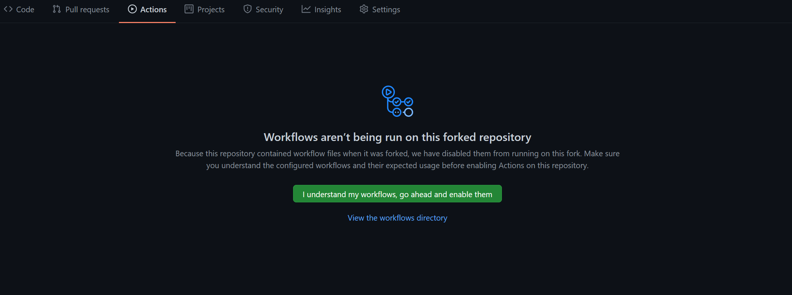

<!--
   Licensed to the Apache Software Foundation (ASF) under one or more
   contributor license agreements.  See the NOTICE file distributed with
   this work for additional information regarding copyright ownership.
   The ASF licenses this file to You under the Apache License, Version 2.0
   (the "License"); you may not use this file except in compliance with
   the License.  You may obtain a copy of the License at

       http://www.apache.org/licenses/LICENSE-2.0

   Unless required by applicable law or agreed to in writing, software
   distributed under the License is distributed on an "AS IS" BASIS,
   WITHOUT WARRANTIES OR CONDITIONS OF ANY KIND, either express or implied.
   See the License for the specific language governing permissions and
   limitations under the License.
-->

# The "Build" Check on Pull Requests

The upstream repository does not automatically build pull requests from
forks. Your pull request is built and tested by the `Build` workflow
(`.github/workflows/build_and_test.yml`) in your own fork, and the "Build"
check on the pull request links to that run. The check is informational: it
does not replace code review or the Apache Yetus precommit run.

## Set Up Your Fork

1. Before your first push, open your fork's **Actions** tab and enable
   workflows:

   

2. Base your branch on the current `trunk`, so that it contains
   `build_and_test.yml`. For example:

   ```bash
   git fetch upstream
   git rebase upstream/trunk
   git push --force-with-lease origin YOUR_BRANCH
   ```

3. Push your branch to your fork. The workflow runs on every push.

The "Build" check appears on the pull request within about 10-20 minutes of
a push, and follows the run until it finishes.

## If the Check Finds No Run

- **No fork run for this commit** (neutral): no `Build` run was found in your
  fork for the pull request's latest commit. Usually Actions is not enabled
  in the fork, or the branch is based on an old `trunk` without the workflow.
  Fix that as described above, then push again. A new run can also take a few
  minutes to appear.
- **Workflows are disabled on the fork** (action required): the workflow
  exists but is disabled. Enable it in your fork's **Actions** tab, then push
  again.

## Rerunning the Build

- To retry failed jobs, open the run from the check and use **Re-run failed
  jobs** in your fork.
- To start a new run without a new commit, run the `Build` workflow from your
  fork's **Actions** tab on your pull request branch. GitHub only offers this
  once your fork's default branch contains the current workflow, so sync
  your fork's `trunk` with upstream first.

A rerun of a build that had already finished can take about an hour,
sometimes longer, to show on the pull request, because finished checks are
revisited in rotation.
