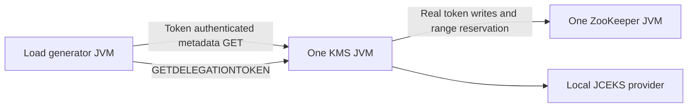

<!-- SPDX-License-Identifier: Apache-2.0 -->

# KMS HTTP throughput benchmark

This opt-in benchmark compares original and fixed delegation-token secret-manager code through real KMS HTTP requests. Each case runs one KMS server JVM, one standalone ZooKeeper JVM, and a separate load-generator JVM. It injects no storage delay and fixes the sequence-number batch size at the trunk default of 100.

## Workloads

A verify operation is `GET /kms/v1/key/benchmark-key/_metadata` with an existing delegation token in the `X-Hadoop-Delegation-Token` header and no authentication cookie. A create operation is `GET /kms/v1/?op=GETDELEGATIONTOKEN&renewer=benchmark&user.name=benchmark` with primary simple authentication and no delegation-token header.

The verify request traverses KMS authentication, delegation-token password verification, authorization, the cached key provider, JSON serialization, and HTTP response processing. The create request traverses KMS primary authentication, token preparation, synchronous ZooKeeper persistence, serialization, and HTTP response processing. A precreated local JCEKS key avoids changing key material during measurement.

The benchmark uses simple authentication for issuance so that only KMS and ZooKeeper servers are needed. It does not measure Kerberos handshakes, TLS, a ZooKeeper quorum, encryption throughput, or production storage/network capacity.



## Fixed comparison matrix

| Dimension | Values |
| --- | --- |
| Code | Original and fixed common jar |
| Verify to create ratio | 100:0, 99:1, 95:5, 90:10 |
| Concurrent HTTP requests | 32 |
| Sequence batch size | 100 |
| Added latency | None |
| Repetitions | Three |
| Warmup per case | Five seconds |
| Measurement per case | Fifteen seconds |

There are eight configurations and 24 cases. The full concurrency sweep is excluded. Warmup and measurement alone take eight minutes; startup, preflight checks, Maven, and draining add overhead. Each case has fresh server processes, ZooKeeper data, and a key store. Each original/fixed pair uses the same seeded request schedule, and pair order alternates across repetitions.

## Authentication and artifact checks

Before loading the server, the harness configures the same test-only diagnostic subclass of KMS's normal pseudo delegation-token handler for both versions. All authentication and token-management behavior delegates to the real implementation. During preflight it counts entry to delegation-token authentication and token-acquisition management operations, checks the actual secret-manager class is `DelegationTokenManager$ZKSecretManager`, checks successful authenticated metadata access, and checks rejection of a token with an invalid password and a request with no credentials. Diagnostic counters are disabled before warmup.

The HTTP client disables cookie management, redirects, and automatic retries. A primary-authentication cookie therefore cannot bypass delegation-token verification, and retry traffic cannot silently change the requested mix. Each successful acquisition response is decoded and its token kind and nonempty identifier/password are checked. Issued tokens are not renewed or cancelled during load.

The child KMS process records its loaded common-jar location and SHA-256 hashes of the actual abstract and ZooKeeper secret-manager class bytes. The comparison runner checks those hashes against the requested jars for every case. The same KMS and client code are used in both versions; only the child server classpaths change. Neither sources nor installed Maven artifacts are modified by the comparison runner.

## Scheduling and measurement boundaries

A shared dispatcher provides a seeded shuffled block of 100 operations with the exact selected ratio. Workers acquire the next operation as soon as their current HTTP request completes. Ratios are based on requests, not counts of dedicated reader/writer threads.

At the time cutoff, the dispatcher finishes submitting the current 100-operation block, then stops and drains. This makes the full submitted ratio exact. Post-cutoff submissions and successful late completions are reported separately. Main goodput is successful completions before the fixed cutoff divided by the configured measurement duration; late completions never inflate it. Actual elapsed time including the block tail and drain is also reported.

Latencies cover requests started before cutoff, including those that finish during drain, so a slow request is not silently removed from tail-latency statistics. Requests started after cutoff do not enter the latency histogram. Latency includes client request construction, HTTP, body consumption, and response validation. Histograms use approximately one-percent logarithmic buckets; percentile values are bucket upper bounds, while maximum latency is exact.

This is a closed-loop capacity benchmark. It does not compensate for coordinated omission and must not be presented as latency under a fixed external arrival rate.

## Metrics and validation

Each case saves total and per-operation goodput; submitted, late-submitted, successful, late-completed, and failed request counts; error categories; per-operation p50/p95/p99/max latency; and measurement/drain duration. Failures are not counted as successful throughput.

KMS, ZooKeeper, and client process snapshots include CPU time, heap usage, live threads, and GC counts/time. ZooKeeper `mntr` snapshots record server latency and outstanding-request counters outside the load window. Those server metrics are cumulative, not per-window percentiles. ZooKeeper data-file sizes describe allocated file size, not physical disk bandwidth. Server logs remain available per case with WARN-level logging configured identically in both versions.

Node counts before and after measurement must increase by exactly the number of completed create operations, including the drained block tail. Runs must have no HTTP/validation errors and the full submitted ratio must match the target. The independent 100:0 control helps identify effects unrelated to creation lock contention. There is no performance pass/fail threshold: a gain or regression is reported as measured.

## Running the benchmark

Use JDK 17 and Maven 3.9.15 or newer, with Hadoop dependencies already built/installed. These tests do not require native libraries. Normal tests run only the scheduler and latency-accounting checks; the HTTP benchmark requires explicit opt-in.

```sh
mvn -o -pl hadoop-common-project/hadoop-kms \
  -Dtest=TestKMSHttpBenchmark -Dkms.benchmark=true \
  -Dmaven.test.failure.ignore=false -Dcheckstyle.skip -Dspotbugs.skip test
```

The defaults are exactly the matrix above. Optional properties are `kms.benchmark.concurrency`, `kms.benchmark.create.percent`, `kms.benchmark.repetitions`, `kms.benchmark.warmup.seconds`, `kms.benchmark.seconds`, `kms.benchmark.output`, `kms.benchmark.label`, and `kms.benchmark.common.jar`. The jar override is prepended only to the child server classpaths, allowing controlled original/fixed comparison without reinstalling dependencies.

Build one original common jar from the baseline checkout and one from the fixed checkout. Keep all other source and dependency versions identical. Then run:

```sh
python3 dev-support/benchmarks/kms-http-benchmark.py \
  --baseline-common /absolute/path/to/original/hadoop-common.jar \
  --fixed-common /absolute/path/to/fixed/hadoop-common.jar \
  --maven mvn \
  --output /absolute/path/to/fresh/results-directory
```

The runner alternates pair order, checks all four mixes and loaded class hashes, and saves incremental `comparison.json` containing raw cases and median/range summaries. Per-case startup logs, configuration, commands, snapshots, and result JSON remain in the output tree. Output directories must be fresh to avoid combining unrelated runs.

## Results

All 24 cases completed with zero HTTP or response-validation errors. Every case had the exact submitted mix, correct token-node growth, and the expected loaded class hashes. The following values are medians of three independent runs at concurrency 32, with five seconds of warmup and fifteen seconds of measurement per run.

| Verify:create | Original requests/s | Fixed requests/s | Ratio | Original verify p99 ms | Fixed verify p99 ms |
| --- | ---: | ---: | ---: | ---: | ---: |
| 100:0 | 30,811 | 30,150 | 0.98x | 4.14 | 4.48 |
| 99:1 | 17,672 | 26,885 | 1.52x | 5.31 | 4.18 |
| 95:5 | 5,349 | 23,949 | 4.48x | 14.22 | 4.31 |
| 90:10 | 3,103 | 23,174 | 7.47x | 21.81 | 3.39 |

| Verify:create | Original throughput range | Fixed throughput range | Original create p99 ms | Fixed create p99 ms |
| --- | ---: | ---: | ---: | ---: |
| 100:0 | 30,317–32,111 | 23,908–30,815 | — | — |
| 99:1 | 16,099–17,731 | 24,820–27,852 | 7.08 | 18.97 |
| 95:5 | 5,120–5,643 | 22,415–28,690 | 17.18 | 21.38 |
| 90:10 | 3,086–3,140 | 22,945–25,814 | 22.47 | 19.35 |

The 100:0 median was 2.1 percent lower for the fixed build. Two fixed control runs measured 30,150 and 30,815 requests/s; the third measured 23,908. Keep that lower observation: the short runs show substantial variability, and three repetitions do not establish statistical significance for small changes.

Mixed-load median throughput increased by 1.52x, 4.48x, and 7.47x as creation increased from one to ten percent. Token-creation p99 increased at 99:1 and 95:5 even while verification improved. These are closed-loop saturation comparisons: fixed-build creation arrival rates were also higher, so the latency results are not matched-arrival-rate comparisons. No claim of uniformly improved creation latency is supported.

ZooKeeper metrics recorded real fsync activity. No artificial delays, renewals, cancellations, concurrency sweep, or batch-size variation were used. These results concern authenticated metadata requests against a local single-server setup, not encryption requests, TLS/Kerberos costs, or a production quorum. They replace secret-manager-only speedups as the end-to-end evidence for this change.

Charts and the public benchmark report are available in [HADOOP-20045](https://issues.apache.org/jira/browse/HADOOP-20045).

## Renewal and cancellation workloads (HADOOP-20046)

Select `--mutation renew` or `--mutation cancel` on the comparison runner (or set
`-Dkms.benchmark.mutation=renew|cancel` on the Java test). The four percentages
then describe verification versus the selected mutation. The legacy
`kms.benchmark.create.percent` property still selects those percentages; output
also records `mutationOperation` and `mutationPercent` explicitly. The generic
`mutation` counters and operation-named counters contain mutation results.

Renewal uses a separate token per worker, leaving the verification tokens
unchanged. Cancellation consumes unique tokens from a pool issued before
warmup. There is no replacement issuance in the load window. Pool creation is
outside both warmup and measurement, but adds setup time and ZooKeeper state.
Use `--cancel-tokens` (default 100000), or `kms.benchmark.cancel.tokens`, to size
that pool for warmup plus measurement. Pool exhaustion fails the case rather
than changing its workload. The token-node validation expects growth for
creation, no change for renewal, and a decrease matching completed cancellations.

Both additional modes preflight renewal, cancellation, and rejection of a
cancelled token. They retain the original authentication checks, no-cookie/no-
retry client behavior, exact submission ratios, latency accounting, and loaded
class fingerprint checks. Benchmark key rotation and expired-key cleanup
separately; these request workloads do not measure either operation.

## Verification during background maintenance

Use `kms-maintenance-benchmark.py` to compare the real KMS secret manager's
maintenance paths while 32 clients issue verification-only HTTP metadata GETs:

```sh
python3 dev-support/benchmarks/kms-maintenance-benchmark.py \
  --baseline-common /absolute/path/to/parent/hadoop-common.jar \
  --fixed-common /absolute/path/to/fixed/hadoop-common.jar \
  --output /absolute/path/to/fresh/maintenance-results
```

The default matrix contains three repetitions of each original/fixed pair,
with alternating pair order and five seconds of HTTP warmup. Measurement lasts
fifteen seconds for key scenarios and at least sixty seconds for the larger
expired-token batch. Each case has fresh KMS/ZooKeeper JVMs. It injects no latency,
does not alter batch size 100, and does not replace the manager or its storage
hooks. A test-only child-process control command invokes the actual maintenance
method through reflection, on a separate thread from the HTTP workers.

| Scenario | Real path and fixed work |
| --- | --- |
| `new-key` | 500 calls to `updateCurrentKey()`; new signing-key installation |
| `rotate` | 500 calls to `rollMasterKey()`; retiring-key updates plus replacement installation |
| `expired-keys` | One rotation with 1,000 expired keys already stored and cached |
| `expired-tokens` | One cleanup with 5,000 expired tokens already stored and cached |

New-key installation in the fixed implementation also persists the retiring
key's expiry before publication. Rotation includes both retiring and new-key
persistence; this is not a synthetic isolated timing of a storage hook without
its caller's lock. Expired-token storage deletion was already outside the API
write lock in the parent; its inclusion measures the cleanup coordination and
conditional-delete changes rather than assuming another global I/O lock fix.
These repeated maintenance batches are stress workloads, not production cadence.

Preparation uses real stored objects and initializes their expired cache state
before warmup. The harness checks exact token/key node-count changes after the
batch, actual loaded class fingerprints, successful maintenance completion
inside the load window, and zero HTTP/validation errors. Normal tests include a
window-accounting regression ensuring stalled requests that finish after
maintenance ends remain in the overlap-latency statistics.

Request timestamps are collected in primitive thread-confined arrays only for
maintenance measurements. The report contains verification completions per
second during the actual maintenance interval, latencies of all requests whose
lifetimes overlap it (including late completions), observed maximum and p99.99,
100 ms completion/maximum-latency time series, whole-window throughput, warmup
throughput, and maintenance duration. Cross-JVM interval alignment uses wall
clock milliseconds, approximately 1 ms resolution; operation duration uses the
child's monotonic clock. This remains a closed-loop benchmark without coordinated
omission correction. A full-window p99 alone can hide a short global stall.

Use `--operations` to select a comma-separated subset. The underlying opt-in
Java test uses `kms.benchmark.maintenance` and
`kms.benchmark.maintenance.work`; select zero mutation percent for these cases.
If the batch outlasts measurement, the case fails rather than truncating it.

The runner supports `--resume` for interrupted comparisons. It checks settings,
work sizes, loaded-class hashes, and the duration of every retained sample,
then skips only validated cases. Failed attempts remain in separate directories.

The HADOOP-20046 results, charts, design, and exported measurements are attached
to [HADOOP-20046](https://issues.apache.org/jira/browse/HADOOP-20046).
The maintenance comparison contains three runs per build and scenario; the
renewal/cancellation 95:5 checks are single runs. Tail latency did not improve
uniformly, so use the full report alongside the throughput numbers.
